# ❤️ Heart Disease Prediction Web App

[](https://www.python.org/)
[](https://streamlit.io/)
[](https://scikit-learn.org/)
[](LICENSE)

An end-to-end Machine Learning solution and interactive clinical decision-support web application for predicting cardiovascular disease risk. Built with **scikit-learn**, serialized with **Joblib**, and deployed as an intuitive web dashboard using **Streamlit**.

---

## 📌 Table of Contents

- [Project Overview](#-project-overview)
- [Workflow & Architecture](#-workflow--architecture)
- [Dataset & Clinical Features](#-dataset--clinical-features)
- [Data Preprocessing & Cleaning](#-data-preprocessing--cleaning)
- [Model Training & Benchmarking](#-model-training--benchmarking)
- [Web Application (app.py)](#-web-application-apppy)
- [Repository Structure](#-repository-structure)
- [Getting Started & Local Setup](#-getting-started--local-setup)
- [How Prediction Works](#-how-prediction-works)
- [Medical Disclaimer](#-medical-disclaimer)
- [Author & License](#-author--license)

---

## 📌 Project Overview

Cardiovascular diseases (CVDs) remain the leading cause of mortality globally, taking an estimated 17.9 million lives each year. Early identification of individuals at high risk allows healthcare professionals to initiate lifestyle interventions and preventive therapies early.

This project implements a complete data science lifecycle:
1. **Exploratory Data Analysis (EDA)** on 918 patient observations.
2. **Clinical Anomaly Handling**: Biologically implausible zero-values in blood pressure and cholesterol are identified and imputed.
3. **Feature Engineering**: Categorical variables are converted via dummy encoding (`drop_first=True`) and normalized using `StandardScaler`.
4. **Model Benchmarking**: 4 machine learning classifiers evaluated across Accuracy and F1 Score with stratified train-test splitting.
5. **Production Deployment**: A responsive, real-time Streamlit dashboard (`app.py`) providing instantaneous risk predictions, percentage probabilities, and clinical recommendations.

---

## 🔄 Workflow & Architecture

```mermaid
flowchart LR
    A["Raw Data (heart.csv)"] --> B["EDA & Anomaly Imputation"]
    B --> C["One-Hot Encoding (drop_first=True)"]
    C --> D["Stratified Train/Test Split (80/20)"]
    D --> E["StandardScaler Normalization"]
    E --> F["Model Benchmarking (KNN, LogReg, NB, SVM)"]
    F --> G["Model Selection: KNN (88.59% Acc, 0.8986 F1)"]
    G --> H["Serialization (.pkl artifacts)"]
    H --> I["Streamlit Web Application (app.py)"]
```



---

## 📊 Dataset & Clinical Features

The dataset (`heart.csv`) contains **918 patient records** and 11 clinical features (5 continuous/numerical, 6 categorical):

| Feature | Type | Description | Normal / Observed Range |
| :--- | :--- | :--- | :--- |
| **Age** | Numerical | Age of the patient | 28 – 77 years (app supports 18–100) |
| **Sex** | Categorical | Biological sex of the patient | `M` (Male), `F` (Female) |
| **ChestPainType** | Categorical | Type of chest pain reported | `TA` (Typical Angina), `ATA` (Atypical Angina), `NAP` (Non-Anginal Pain), `ASY` (Asymptomatic) |
| **RestingBP** | Numerical | Resting blood pressure | 80 – 200 mm Hg |
| **Cholesterol** | Numerical | Serum cholesterol level | 100 – 603 mg/dL |
| **FastingBS** | Categorical | Fasting blood sugar level | `1` = > 120 mg/dL, `0` = ≤ 120 mg/dL |
| **RestingECG** | Categorical | Resting electrocardiographic results | `Normal`, `ST` (ST-T wave abnormality), `LVH` (Left ventricular hypertrophy) |
| **MaxHR** | Numerical | Maximum heart rate achieved during exercise | 60 – 202 bpm |
| **ExerciseAngina**| Categorical | Exercise-induced angina | `Y` (Yes), `N` (No) |
| **Oldpeak** | Numerical | ST depression induced by exercise relative to rest | -2.6 – 6.2 (app supports 0.0–6.0) |
| **ST_Slope** | Categorical | Peak exercise ST segment slope | `Up` (Upsloping), `Flat` (Flat), `Down` (Downsloping) |
| **HeartDisease** | Target | Ground truth cardiovascular disease status | `1` = High Risk / Positive, `0` = Low Risk / Negative |

### Class Distribution
- **Heart Disease Positive (`1`)**: 508 patients (55.3%)
- **Heart Disease Negative (`0`)**: 410 patients (44.7%)

---

## 🧹 Data Preprocessing & Cleaning

As shown in `HeartdiseaseFinal.ipynb`:
1. **Handling Biologically Implausible Zeros**:
   - **Serum Cholesterol**: 172 records contained `0 mg/dL` (biologically impossible for living patients). Imputed with the mean of all non-zero cholesterol values (**244.64 mg/dL**).
   - **Resting Blood Pressure**: 1 record contained `0 mm Hg`. Imputed with the mean of all non-zero resting blood pressure values (**132.54 mm Hg**).
2. **Missing & Duplicate Values**:
   - `df.isnull().sum()` confirmed 0 missing values.
   - `df.duplicated().sum()` confirmed 0 duplicate rows.
3. **Categorical Encoding**:
   - Transformed categorical columns using `pd.get_dummies(df, drop_first=True)` to prevent multicollinearity.
   - Converted boolean masks to integers (`.astype(int)`).
   - Expanded the 11 original features into **15 engineered model features**:
     `['Age', 'RestingBP', 'Cholesterol', 'FastingBS', 'MaxHR', 'Oldpeak', 'Sex_M', 'ChestPainType_ATA', 'ChestPainType_NAP', 'ChestPainType_TA', 'RestingECG_Normal', 'RestingECG_ST', 'ExerciseAngina_Y', 'ST_Slope_Flat', 'ST_Slope_Up']`
4. **Data Splitting**:
   - Stratified train-test split (`stratify=y`, `test_size=0.2`, `random_state=42`) ensuring balanced target proportions:
     - **Training Set**: 734 samples (80%)
     - **Test Set**: 184 samples (20%)
5. **Feature Scaling**:
   - `StandardScaler` was fitted strictly on `X_train` and applied to transform both `X_train` and `X_test` to prevent data leakage.

---

## 🏆 Model Training & Benchmarking

Four supervised classification algorithms were trained and benchmarked on the standardized test partition (`HeartdiseaseFinal.ipynb`):

| Rank | Model | Accuracy | F1 Score | Notes |
| :---: | :--- | :---: | :---: | :--- |
| 🥇 | **K-Nearest Neighbors (KNN)** | **88.59%** | **0.8986** | **Top Performer** (Selected for production) |
| 🥈 | **Logistic Regression** | **87.50%** | **0.8878** | High linear separability |
| 🥉 | **Naive Bayes (GaussianNB)** | **86.96%** | **0.8788** | Strong probabilistic baseline |
| 4️⃣ | **Support Vector Machine (SVM)** | **86.41%** | **0.8804** | RBF kernel, `probability=True` |

### Why K-Nearest Neighbors (KNN) Won
- The KNN classifier achieved the best trade-off between sensitivity and precision, yielding an **F1 Score of 0.8986** and **Accuracy of 88.59%**.
- In cardiovascular clinical indicators, patients with similar biometric clusters (e.g., flat/downsloping ST segment, exercise-induced angina, asymptomatic chest pain) frequently share disease risk profiles, allowing distance-based neighborhood models to capture nonlinear decision boundaries effectively.

### Serialized Model Artifacts
The training pipeline exports 3 artifacts for application serving:
- `KNN_heart.pkl`: Fitted `KNeighborsClassifier(n_neighbors=5, metric='minkowski', p=2)` model.
- `scaler.pkl`: Fitted `StandardScaler` instance containing feature means and variances.
- `columns.pkl`: Ordered list of the 15 expected feature names to guarantee deterministic inference.

---

## 🖥️ Web Application (`app.py`)

The application provides an intuitive diagnostic interface built with Streamlit:

### Key Features
- **Responsive 2-Column Clinical Form**: Clean input sliders and dropdown selectors for patient vitals.
- **Contextual Medical Tooltips**: Clarifies clinical abbreviations (`ATA`, `NAP`, `TA`, `ASY`, `LVH`, `ST_Slope`, etc.) for users and healthcare practitioners.
- **Dynamic Preprocessing Pipeline**: Automatically maps raw user inputs into the 15-dimensional dummy-encoded vector using `columns.pkl` (handling reference categories cleanly).
- **Standardized Feature Scaling**: Applies the serialized `StandardScaler` before passing inputs to the model.
- **Risk Score & Probability Breakdown**: Displays binary classification (`High Risk` vs. `Low Risk`) alongside a calibrated risk percentage (`model.predict_proba`).
- **Actionable Health Recommendations**: Context-sensitive guidance based on the patient's predicted risk level.

---

## 📁 Repository Structure

```text
heartDiseasePredictor/
├── .gitignore               # Ignores .venv, __pycache__, checkpoints, and OS artifacts
├── app.py                   # Streamlit interactive web application
├── HeartdiseaseFinal.ipynb  # End-to-end Jupyter Notebook (EDA, preprocessing, benchmarking)
├── heart.csv                # Heart disease clinical dataset (918 records)
├── KNN_heart.pkl            # Serialized production KNN model artifact
├── scaler.pkl               # Serialized StandardScaler artifact
├── columns.pkl              # Serialized expected feature column names list
├── requirements.txt         # Production Python dependencies
└── README.md                # Comprehensive project documentation
```

---

## 🚀 Getting Started & Local Setup

Follow these instructions to run the application locally.

### Prerequisites
- Python 3.10 or higher
- Git

### 1. Clone the Repository
```bash
git clone https://github.com/adarshjnv9100/heartDiseasePredictor.git
cd heartDiseasePredictor
```

### 2. Create and Activate a Virtual Environment

**On Windows (PowerShell):**
```powershell
python -m venv .venv
.\.venv\Scripts\Activate.ps1
```

**On macOS / Linux:**
```bash
python3 -m venv .venv
source .venv/bin/activate
```

### 3. Install Required Dependencies
```bash
pip install -r requirements.txt
```

### 4. Launch the Streamlit Application
```bash
streamlit run app.py
```

Once running, access the application in your browser at:
```text
http://localhost:8501
```

### 5. Running the Jupyter Notebook (Optional)
To inspect or rerun the training and EDA pipeline:
```bash
pip install notebook
jupyter notebook HeartdiseaseFinal.ipynb
```

---

## 💡 How Prediction Works

1. **User Input Collection**: The user selects or adjusts 11 biometric parameters via the Streamlit UI.
2. **Payload Construction**: Categorical variables are converted into dummy keys (e.g., `Sex_M: 1`, `ST_Slope_Flat: 1`).
3. **Column Alignment**: Missing dummy columns (representing the reference categories dropped during `drop_first=True`) are filled with `0`, and all columns are aligned with `columns.pkl`.
4. **Feature Normalization**: The 15-element feature vector is transformed using `scaler.pkl`:
   $$\mathbf{z} = \frac{\mathbf{x} - \boldsymbol{\mu}}{\boldsymbol{\sigma}}$$
5. **Inference**:
   - `model.predict(scaled_input)` yields `0` (Low Risk) or `1` (High Risk).
   - `model.predict_proba(scaled_input)` computes the risk probability percentage.
6. **Result Display**: Outputs color-coded risk alerts and personalized health recommendations.

---

## ⚠️ Medical Disclaimer

> **Important**: This software and predictive model are intended strictly for **educational, academic, and portfolio demonstration purposes**. It is not a certified medical diagnostic device and must **never** be used as a substitute for professional clinical diagnosis, consultation, or emergency care. Always consult a qualified physician or healthcare provider for medical concerns.

---

## 👤 Author & Acknowledgments

- **Author**: [Adarsh](https://github.com/adarshjnv9100)
- **Repository**: [heartDiseasePredictor](https://github.com/adarshjnv9100/heartDiseasePredictor)
- **Dataset**: Heart Failure Prediction Dataset (combining Cleveland, Hungarian, Switzerland, Long Beach V, and Stalog datasets).

If you find this project useful, please consider giving it a ⭐ on GitHub!
